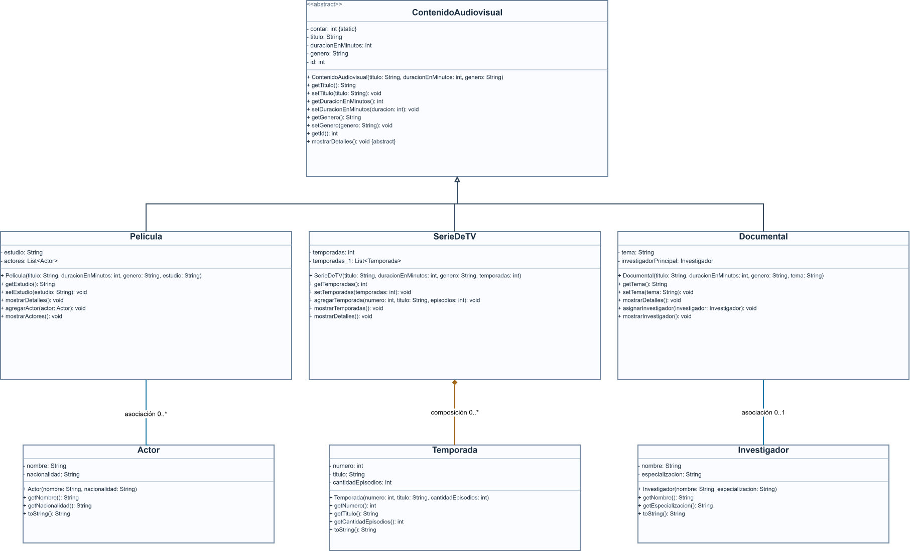

# Sistema de Contenidos Audiovisuales — POO

Proyecto académico en **Java** para la asignatura de **Programación Orientada a Objetos** de la **Universidad Politécnica Salesiana**. Se amplía un proyecto base de contenidos audiovisuales para practicar **herencia, polimorfismo, asociación y composición** mediante la creación y manipulación de objetos.

## Objetivo

Representar diferentes tipos de contenido audiovisual y sus relaciones con actores, temporadas e investigadores, aplicando los principios de la programación orientada a objetos.

## Funcionalidades

- Registrar y mostrar información de películas, series de televisión, documentales, animes y videos educativos.
- Asignar identificadores automáticos a los objetos que heredan de `ContenidoAudiovisual`.
- Asociar varios actores con una película.
- Crear y registrar temporadas dentro de una serie de televisión o un anime.
- Asociar un investigador principal con un documental o un asesor científico con un video educativo.
- Recorrer contenidos de distintas subclases mediante un arreglo de `ContenidoAudiovisual` y ejecutar `mostrarDetalles()` de forma polimórfica.

## Clases del proyecto

| Clase                  | Función                                                                 |
| ---------------------- | ----------------------------------------------------------------------- |
| `ContenidoAudiovisual` | Clase base abstracta: identificador, título, duración y género.         |
| `Pelicula`             | Contenido con estudio productor y una lista de actores.                 |
| `SerieDeTV`            | Contenido con cantidad de temporadas y registro de objetos `Temporada`. |
| `Documental`           | Contenido con tema e investigador principal.                            |
| `Actor`                | Nombre y nacionalidad de un actor.                                      |
| `Temporada`            | Número, título y cantidad de episodios.                                 |
| `Investigador`         | Nombre y especialización de un investigador.                            |
| `Anime`                | Contenido con estudio de animación, año de estreno y temporadas.        |
| `VideoEducativo`       | Contenido con tema, nivel educativo y asesor científico.                |

### Relaciones entre clases

- **Herencia:** `Pelicula`, `SerieDeTV`, `Documental`, `Anime` y `VideoEducativo` extienden `ContenidoAudiovisual`.
- **Asociación:** `Pelicula` → `Actor`; `Documental` → `Investigador`; `VideoEducativo` → `Investigador`.
- **Composición:** `SerieDeTV` → `Temporada`; `Anime` → `Temporada`. Las clases contenedoras crean las temporadas mediante `agregarTemporada()`.
- **Polimorfismo:** el método sobrescrito `mostrarDetalles()` se invoca desde un arreglo de referencias `ContenidoAudiovisual`.

## Estructura del proyecto

```text
poo_unidad1/
├── .classpath
├── .project
├── src/
│   ├── poo/
│   │   └── PruebaAudioVisual.java      # Clase principal (main)
│   └── uni1a/
│       ├── ContenidoAudiovisual.java
│       ├── Pelicula.java
│       ├── SerieDeTV.java
│       ├── Documental.java
│       ├── Actor.java
│       ├── Temporada.java
│       ├── Investigador.java
│       ├── Anime.java
│       └── VideoEducativo.java
└── README.md
```

## Requisitos

- **Java JDK** instalado.
- **Eclipse IDE** con soporte para desarrollo Java.
- **Git** (opcional, para clonar desde la terminal).

El proyecto utiliza la biblioteca estándar de Java y no requiere dependencias externas.

## Instalación y ejecución

1. Clona el repositorio:

   ```bash
   git clone https://github.com/Diego-Villota/poo_unidad1.git
   ```

   También se puede descargarlo como archivo .Zip.

2. Abrir **Eclipse IDE**.
3. Selecciona **File → Import → General → Existing Projects into Workspace**.
4. En **Select root directory**, elige la carpeta `poo_unidad1` y termina la importación con **Finish**.
5. Abre `src/poo/PruebaAudioVisual.java`.
6. Ejecuta **Run As → Java Application**.
7. Consulta los resultados en la pestaña **Console** de Eclipse.

## Ejemplo de funcionamiento

La clase `PruebaAudioVisual` crea objetos correspondientes a **Avatar**, **Game of Thrones**, **Cosmos**, **Jujutsu Kaisen** y **Explorando el Sistema Solar**. Luego establece relaciones con actores, temporadas e investigadores y muestra los detalles de cada contenido.

Entre las operaciones utilizadas se encuentran:

```java
pelicula.agregarActor(actor1);
serie.agregarTemporada(1, "Primera temporada", 10);
documental.asignarInvestigador(investigador);
anime.agregarTemporada(1, "Primera temporada", 24);
video.asignarInvestigador(asesor);
```

Estas variables se crean en `PruebaAudioVisual.java` antes de ejecutar los métodos. La salida aparece en consola.

## Mejoras realizadas

En comparación con el proyecto base, se incorporaron:


1. Las clases `Actor`, `Temporada` e `Investigador`, con sus relaciones con las clases originales.
2. Las subclases `Anime` y `VideoEducativo`, con atributos, constructores y métodos propios.
3. Relaciones adicionales de composición y asociación para las nuevas subclases.
4. Pruebas de creación de objetos y de sus relaciones en el método `main`.

## Diagramas UML

### Etapa 3: Relaciones entre clases



### Etapa 4: Expansión con nuevas subclases


